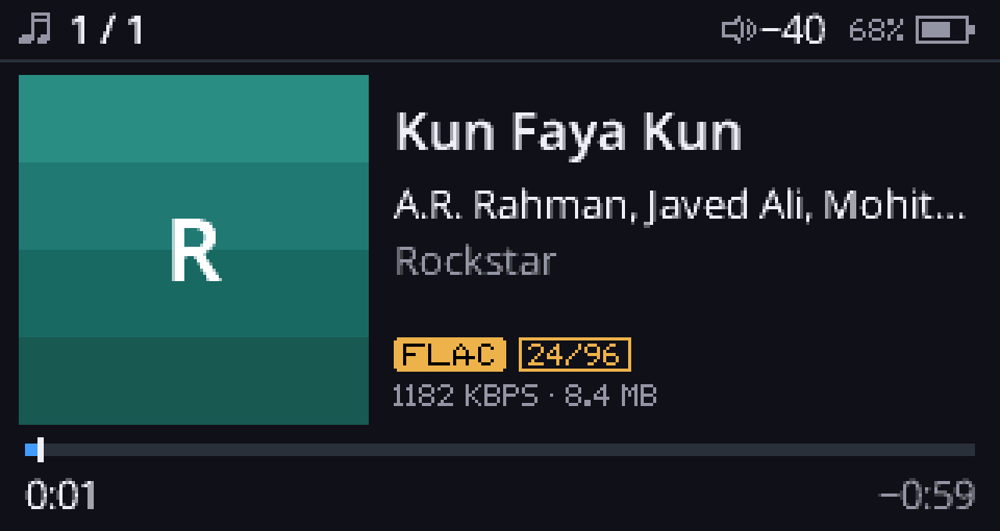
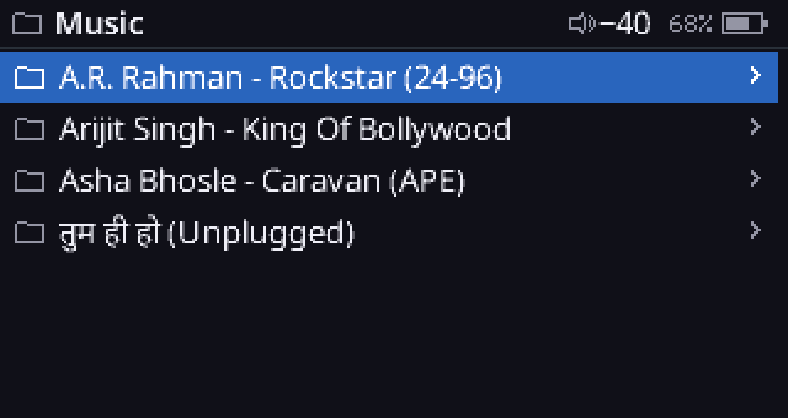
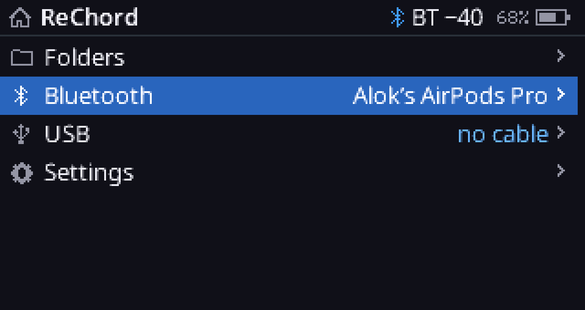
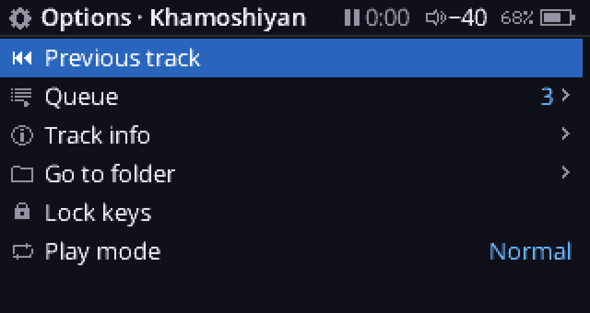
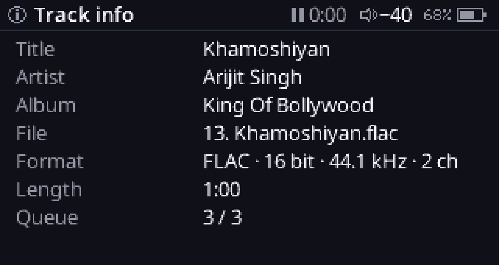
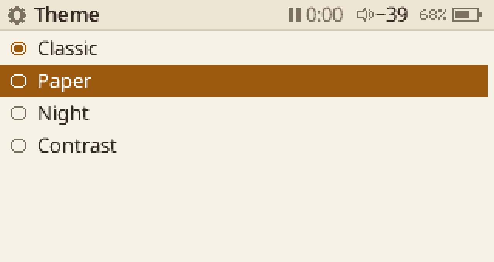

# ReChord

A free, from-source custom firmware for the **SNOWSKY (FiiO) Echo Mini**: our own code on both
of the player's cores, from boot to the screen you see. This line targets the **512 MB board**
and is the player's daily firmware on one 512 MB unit.

<p>


</p>
<p>


</p>
<p>


</p>

*Screenshots are QEMU renders of the same firmware image that runs on the device (2x scale;
the panel is 320×170).*

## What it does

**Playback**
- **Gapless and bit-exact**, across track boundaries and sample-rate changes.
- **Formats:** FLAC, WAV/AIFF (integer and float), MP3, AAC/HE-AAC, ALAC, Ogg Vorbis, Opus,
  WavPack, APE, WMA (v1/v2, Pro, Lossless), DSD (DSF/DFF).
- **Decoding:** core B decodes; core A feeds it and the DACs (two CS43131).
- **Library basics:** tags (ID3v2/ID3v1/APEv2/Vorbis/MP4/RIFF), a play queue, play modes, and
  resume after power-off.

**Interface**
- **Header:** a status line on every screen with play state, volume, a Bluetooth icon while
  earphones are linked, and the battery.
- **Lists:** seven rows, with cursor memory per level.
- **Now Playing:** shows the cover tile, title, artist and album, format and rate badges, bit
  rate, progress, and the next track.
- **Keys:** each key has one meaning everywhere.
  - VOL+/VOL− move in lists and set the volume on Now Playing.
  - PLAY opens or plays.
    - On Now Playing: tap to pause, 2× for next, 3× for previous, hold for next.
  - BACK goes up; hold BACK for Home.
  - MENU switches between Now Playing and the library; hold MENU for Options.
- **Text and themes:** Noto Sans in five sizes, with Latin, curly quotes and Devanagari, and
  four themes: Classic, Paper, Night and Contrast.
- **Fast:** keys are sampled every 10 ms on a timer and timed in milliseconds. Each key press
  repaints only what changed. On the device, a key reaches the screen in about 8 ms (median).

**Connections**
- **USB disk:** internal storage read/write, microSD read-only.
- **USB DAC:** UAC2, bit-perfect 16/24/32-bit at 44.1–192 kHz, with media keys and a choice of
  DAC power source.
- **USB-C earphones:** the player acts as a USB audio host.
- **Bluetooth earphones** (the JieLi module):
  - scan, connect, and reconnect after a drop;
  - earphone keys work;
  - the USB DAC can stream to Bluetooth.

**Never stuck**
- A power-cut-safe updater keeps two firmware slots.
- A boot guard and a crash record catch faults.
- **Recovery:** hold VOL+ at power-on.
- **USB loader:** hold VOL− at power-on.
- **The boot ROM's maskrom** is always the last resort, and nothing in ReChord touches what it
  reads at reset.

## Status

"Device" means verified on a real 512 MB unit and recorded in its own log; "QEMU" means
covered by the emulator test suite. The full table is in [docs/ROADMAP.md](docs/ROADMAP.md).

| Area | Verified |
|---|---|
| Boot, clocks, storage (SD NAND / eMMC / microSD, FAT/exFAT) | device |
| Gapless dual-core audio, FLAC (all formats bit-exact in QEMU) | device, QEMU |
| New UI, fonts, gestures, themes | device (2026-10-18) |
| USB disk, USB DAC, power, battery | device |
| Bluetooth earphones, reconnect, routing | device |
| USB-C earphones, VOP + DMA display path | QEMU |

**512 MB board only, so far.** The differences from the 8 GB board come from comparing the stock
firmware of both. They're documented in [docs/BOARD_DIFF_512M.md](docs/BOARD_DIFF_512M.md) and
selected at build time (`BOARD=512m | 8g`). The 8 GB build has not been tested on hardware.

**Next:**
- the DMA display path on the device (~8 ms a screen instead of ~90 ms)
- seek
- a library index
- EQ and ReplayGain on core B
- an on-device self-test mode
- hardware decoding
- a Bluetooth control channel

See [docs/ROADMAP.md](docs/ROADMAP.md).

## Install

> Keep the stock firmware at hand. Flashing modified firmware is at your own risk.

- **Updater:** copy `MINIV900.IMG` (512 MB board) to the player's root, eject, and confirm on
  the player.
- **Maskrom:**
  1. Unplug USB, press RST with a paperclip, hold every key except power, and plug USB in.
  2. Pad the image to 512-byte sectors and write it with `rkdeveloptool wl` to both firmware
     slots, LBA `0` and `0x11000` on the 512 MB board.
  3. Read both slots back and compare them.

  Use only `ld`, `td`, `rid`, `rfi`, `rl`, `wl` and `rd`; never `db`. See
  [docs/DEBRICK-LINUX.md](docs/DEBRICK-LINUX.md).

Stock goes back the same way.

## Build

```bash
export PATH=<arm-gnu-toolchain>/bin:$PATH
make cfw-ap -j8                               # core A: build/cfw/rechord_ap.elf
make cfw-img FONT_IMG=<stock MINIV390.IMG>    # + core-B codec images and the fonts module
# -> build/MINIV900.IMG (512 MB board); BOARD=8g -> build/HIFIEC90.IMG
make host-tests                               # host unit tests
```

On a filesystem with coarse timestamps (exFAT), build from clean: `rm -rf build/cfw build/coreb`.

## How it is built

- **Core A** (our `fw1`) runs boot, clocks and power, the UI, storage, USB (mass storage,
  UAC2 DAC, host), the Bluetooth module, and the core-B feed.
  - It's clocked by power state.
  - Storage writes go through a queue that never stalls the main loop or the audio.
- **Core B** runs one decoder image per codec family, loaded from the firmware slot when a
  track needs it.
  - It decodes into a PCM ring.
  - Core A's DMA streams that ring to I2S.
- **The display:**
  - a display list rendered in 16-row bands;
  - dirty rectangles pushed through column windows;
  - a GPIO bus writer by default, and a VOP + DMA path behind a trial guard.
- **The mask ROM** is the fixed boot ROM. It isn't replaced, and nothing writes what it reads at
  reset.

```
firmware/
  startup/   core A start-up, main loop, the app glue (ap_ui.c, ap_bt.c, ap_tick.c, ap_bg.c)
  ui/        the frame, lists, screens, navigation (nav.c, screens.c)
  drivers/   clocks, panel (GPIO / VOP + DMA), text engine and fonts, icons, eMMC/SD, USB
             (MSC, UAC2, host), CS43131, JieLi BT
  services/  config, log, input and gestures, FAT/exFAT, tags, queue, updater, boot guard
  audio/     core A's audio engine, container parsers (MP4, ASF, APE)
  coreb/     core B runtime and decoders
  theme/     theme tokens and the built-in themes
docs/        ROADMAP (start here), BT_DEVICE_NOTES, BOARD_DIFF_512M, hardware and RE notes
```

Every change is proven first in a QEMU machine of the player:
- **Strict models:** the panel, VOP/DMA, eMMC/SD NAND, USB, the JieLi module, the DACs and the
  boot ROM's handoff.
- **Checkers:** any hardware misuse fails the run as a "VIOLATION".
- **Mutants:** deliberately broken builds prove each checker fires.
- **A milestone suite:** boot, audio bit-exactness, every codec, USB, Bluetooth, keys, the UI's
  screenshots, recovery.

That machine and the suite live in a separate repository, not published yet.

## Sources and acknowledgements

- **Upstream:** this repository is a fork of
  [brnomt/ReChord](https://github.com/brnomt/ReChord), which started the from-source idea. The
  512 MB line here has since been rewritten largely independently. Ideas from upstream's later
  work are noted in [docs/UPSTREAM_IDEAS.md](docs/UPSTREAM_IDEAS.md).
- **The stock firmware is the main source.** We disassembled and decompiled the official
  firmware images and traced them in QEMU to learn:
  - the boot path and the board differences;
  - the panel, keys, storage, DACs and USB PHY;
  - **all of the Bluetooth support.**

  The Rockchip RKNanoD SDK, the chip datasheets and the FCC filing photos settled what the code
  didn't.
- **RECHO is the second reference.** [RECHO](https://recho.atzkey.workers.dev) is the
  closed-source custom firmware for the Echo Mini (earlier RefCFW), and it showed first what
  this hardware can do. We decompiled RECHO 0.9.2 and 0.10.0 and traced them in QEMU to learn
  from them. Several parts of ReChord copy what RECHO does, rewritten in our own C:
  - the PLL/clock sequence;
  - I2S/DMA;
  - backlight and power;
  - the battery reading;
  - the shortcuts;
  - the settings format and its defaults.

  Those places say "RECHO" in their source comments.

  **Please support RECHO's developers:** <https://ko-fi.com/miauk>.
- **Libraries:**
  - Rockbox (libdemac, libwma, libwmapro)
  - FFmpeg (WMA Lossless)
  - libmad
  - FAAD2
  - Tremor and libogg
  - libopus and opusfile
  - WavPack
  - Noto Sans fonts (SIL OFL 1.1)

  Their licenses are in their directories.

## License and disclaimer

GPL-3.0 (see `LICENSE`); bundled libraries keep their own licenses. ReChord is independent: it
is not affiliated with FiiO, SNOWSKY, Rockchip or the RECHO developers. No firmware images
(stock or RECHO) are distributed here.
